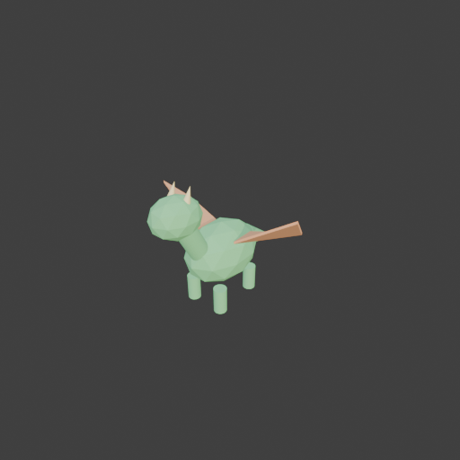
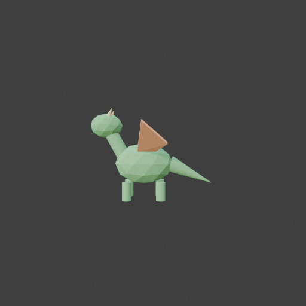

# Sohbet

- `ToolSearch` {"query": "select:mcp__blender__create_primitive,mcp__blender__delete_object,mcp__blender__transform_object,mcp__blender__set_material,mcp__blender__frame_view,mcp__blender__capture_viewport,mcp__blender__export_gltf,mcp__blender__join_objects,mcp__blender__inspect_scene,mcp__blender__create_mesh,mcp__blender__set_shading", "max_results": 11}
- `mcp__blender__delete_object` {"name": "Cube"}
  > {"success":true,"tool":"delete_object","data":{"deleted":true,"exists":false,"object_name":"Cube","type":"MESH","previous_state":{"location":[0,0,0],"rotation":[0,0,0],"scale":[1,1,1]}},"error":null}
- `mcp__blender__create_primitive` {"primitive_type": "ICOSPHERE", "name": "Body", "size": 1, "location": [0, 0, 0.6], "scale": [0.7, 1, 0.7]}
  > {"success":true,"tool":"create_primitive","data":{"created":true,"exists":true,"object_name":"Body","primitive_type":"ICOSPHERE","type":"MESH","location":[0,0,0.6],"rotation":[0,0,0],"scale":[0.7,1,0.7],"vertex_count":42,"face_count":80},"error":null}
- `mcp__blender__create_primitive` {"primitive_type": "CYLINDER", "name": "Neck", "size": 0.5, "location": [0, -0.45, 0.9], "rotation": [0.5, 0, 0], "scale": [0.45, 0.45, 1]}
  > {"success":true,"tool":"create_primitive","data":{"created":true,"exists":true,"object_name":"Neck","primitive_type":"CYLINDER","type":"MESH","location":[0,-0.45,0.9],"rotation":[0.5,0,0],"scale":[0.45,0.45,1],"vertex_count":64,"face_count":34},"error":null}
- `mcp__blender__create_primitive` {"primitive_type": "ICOSPHERE", "name": "Head", "size": 0.5, "location": [0, -0.65, 1.25], "scale": [0.9, 1.1, 0.85]}
  > {"success":true,"tool":"create_primitive","data":{"created":true,"exists":true,"object_name":"Head","primitive_type":"ICOSPHERE","type":"MESH","location":[0,-0.65,1.25],"rotation":[0,0,0],"scale":[0.9,1.1,0.85],"vertex_count":42,"face_count":80},"error":null}
- `mcp__blender__create_primitive` {"primitive_type": "CONE", "name": "Horn_L", "size": 0.2, "location": [0.1, -0.58, 1.45], "rotation": [-0.4, 0, 0], "scale": [0.5, 0.5, 1]}
  > {"success":true,"tool":"create_primitive","data":{"created":true,"exists":true,"object_name":"Horn_L","primitive_type":"CONE","type":"MESH","location":[0.1,-0.58,1.45],"rotation":[-0.4,0,0],"scale":[0.5,0.5,1],"vertex_count":33,"face_count":33},"error":null}
- `mcp__blender__create_primitive` {"primitive_type": "CONE", "name": "Horn_R", "size": 0.2, "location": [-0.1, -0.58, 1.45], "rotation": [-0.4, 0, 0], "scale": [0.5, 0.5, 1]}
  > {"success":true,"tool":"create_primitive","data":{"created":true,"exists":true,"object_name":"Horn_R","primitive_type":"CONE","type":"MESH","location":[-0.1,-0.58,1.45],"rotation":[-0.4,0,0],"scale":[0.5,0.5,1],"vertex_count":33,"face_count":33},"error":null}
- `mcp__blender__create_primitive` {"primitive_type": "CONE", "name": "Tail", "size": 0.8, "location": [0, 0.81, 0.43], "rotation": [-2, 0, 0], "scale": [0.35, 0.35, 1]}
  > {"success":true,"tool":"create_primitive","data":{"created":true,"exists":true,"object_name":"Tail","primitive_type":"CONE","type":"MESH","location":[0,0.81,0.43],"rotation":[-2,0,0],"scale":[0.35,0.35,1],"vertex_count":33,"face_count":33},"error":null}
- `mcp__blender__create_primitive` {"primitive_type": "CYLINDER", "name": "Leg_FL", "size": 0.3, "location": [0.2, -0.28, 0.15], "scale": [0.5, 0.5, 1]}
  > {"success":true,"tool":"create_primitive","data":{"created":true,"exists":true,"object_name":"Leg_FL","primitive_type":"CYLINDER","type":"MESH","location":[0.2,-0.28,0.15],"rotation":[0,0,0],"scale":[0.5,0.5,1],"vertex_count":64,"face_count":34},"error":null}
- `mcp__blender__create_primitive` {"primitive_type": "CYLINDER", "name": "Leg_FR", "size": 0.3, "location": [-0.2, -0.28, 0.15], "scale": [0.5, 0.5, 1]}
  > {"success":true,"tool":"create_primitive","data":{"created":true,"exists":true,"object_name":"Leg_FR","primitive_type":"CYLINDER","type":"MESH","location":[-0.2,-0.28,0.15],"rotation":[0,0,0],"scale":[0.5,0.5,1],"vertex_count":64,"face_count":34},"error":null}
- `mcp__blender__create_primitive` {"primitive_type": "CYLINDER", "name": "Leg_BL", "size": 0.3, "location": [0.2, 0.28, 0.15], "scale": [0.5, 0.5, 1]}
  > {"success":true,"tool":"create_primitive","data":{"created":true,"exists":true,"object_name":"Leg_BL","primitive_type":"CYLINDER","type":"MESH","location":[0.2,0.28,0.15],"rotation":[0,0,0],"scale":[0.5,0.5,1],"vertex_count":64,"face_count":34},"error":null}
- `mcp__blender__create_primitive` {"primitive_type": "CYLINDER", "name": "Leg_BR", "size": 0.3, "location": [-0.2, 0.28, 0.15], "scale": [0.5, 0.5, 1]}
  > {"success":true,"tool":"create_primitive","data":{"created":true,"exists":true,"object_name":"Leg_BR","primitive_type":"CYLINDER","type":"MESH","location":[-0.2,0.28,0.15],"rotation":[0,0,0],"scale":[0.5,0.5,1],"vertex_count":64,"face_count":34},"error":null}
- `mcp__blender__create_mesh` {"name": "Wing_L", "vertices": [[0.25, -0.1, 0.8], [0.25, 0.2, 0.8], [0.9, 0, 1.2], [0.8, 0.35, 0.9], [0.25, -0.1, 0.83], [0.25, 0.2, 0.83], [0.9, 0, 1.23], [0.8, 0.35, 0.93]], "faces": [[4, 5, 7, 6], [0, 2, 3, 1], [0, 4, 6, 2], [2, 6, 7, 3], [3, 7, 5, 1], [1, 5, 4, 0]]}
  > {"success":true,"tool":"create_mesh","data":{"object_name":"Wing_L","type":"MESH","exists":true,"location":[0,0,0],"rotation":[0,0,0],"scale":[1,1,1],"vertex_count":8,"face_count":6,"triangle_count":12,"local_bounds_min":[0.25,-0.1,0.8],"local_bounds_max":[0.9,0.35,1.23],"dimensions":[0.65,0.45,0.43 ... [31 more characters]
- `mcp__blender__create_mesh` {"name": "Wing_R", "vertices": [[-0.25, -0.1, 0.8], [-0.25, 0.2, 0.8], [-0.9, 0, 1.2], [-0.8, 0.35, 0.9], [-0.25, -0.1, 0.83], [-0.25, 0.2, 0.83], [-0.9, 0, 1.23], [-0.8, 0.35, 0.93]], "faces": [[6, 7, 5, 4], [1, 3, 2, 0], [2, 6, 4, 0], [3, 7, 6, 2], [1, 5, 7, 3], [0, 4, 5, 1]]}
  > {"success":true,"tool":"create_mesh","data":{"object_name":"Wing_R","type":"MESH","exists":true,"location":[0,0,0],"rotation":[0,0,0],"scale":[1,1,1],"vertex_count":8,"face_count":6,"triangle_count":12,"local_bounds_min":[-0.9,-0.1,0.8],"local_bounds_max":[-0.25,0.35,1.23],"dimensions":[0.65,0.45,0. ... [33 more characters]
**Ajan:** Renkleri verip kontrol edeyim.

- `mcp__blender__set_material` {"object_name": "Body", "material_name": "DragonGreen", "base_color": [0.25, 0.7, 0.3], "roughness": 0.8}
  > {"success":true,"tool":"set_material","data":{"material_name":"DragonGreen","object_name":"Body","slot_index":0,"changed":["base_color","roughness"],"before":null,"after":{"assigned_objects":["Body"],"is_linked":false,"library_name":null,"material_name":"DragonGreen","node_summary":{"node_count":2," ... [626 more characters]
- `mcp__blender__set_material` {"object_name": "Horn_L", "material_name": "HornYellow", "base_color": [1, 0.85, 0.4]}
  > {"success":true,"tool":"set_material","data":{"material_name":"HornYellow","object_name":"Horn_L","slot_index":0,"changed":["base_color"],"before":null,"after":{"assigned_objects":["Horn_L"],"is_linked":false,"library_name":null,"material_name":"HornYellow","node_summary":{"node_count":2,"node_types ... [613 more characters]
- `mcp__blender__set_material` {"object_name": "Wing_L", "material_name": "WingOrange", "base_color": [1, 0.5, 0.25]}
  > {"success":true,"tool":"set_material","data":{"material_name":"WingOrange","object_name":"Wing_L","slot_index":0,"changed":["base_color"],"before":null,"after":{"assigned_objects":["Wing_L"],"is_linked":false,"library_name":null,"material_name":"WingOrange","node_summary":{"node_count":2,"node_types ... [613 more characters]
- `ToolSearch` {"query": "select:mcp__blender__assign_material", "max_results": 1}
- `mcp__blender__assign_material` {"object_name": "Neck", "material_name": "DragonGreen"}
  > {"success":true,"tool":"assign_material","data":{"assigned":true,"object_name":"Neck","material_name":"DragonGreen","slot_index":0,"before":{"material_name":null},"after":{"object_name":"Neck","slot_index":0,"material_name":"DragonGreen"},"actual":{"object_name":"Neck","slot_index":0,"material_name" ... [30 more characters]
- `mcp__blender__assign_material` {"object_name": "Head", "material_name": "DragonGreen"}
  > {"success":true,"tool":"assign_material","data":{"assigned":true,"object_name":"Head","material_name":"DragonGreen","slot_index":0,"before":{"material_name":null},"after":{"object_name":"Head","slot_index":0,"material_name":"DragonGreen"},"actual":{"object_name":"Head","slot_index":0,"material_name" ... [30 more characters]
- `mcp__blender__assign_material` {"object_name": "Tail", "material_name": "DragonGreen"}
  > {"success":true,"tool":"assign_material","data":{"assigned":true,"object_name":"Tail","material_name":"DragonGreen","slot_index":0,"before":{"material_name":null},"after":{"object_name":"Tail","slot_index":0,"material_name":"DragonGreen"},"actual":{"object_name":"Tail","slot_index":0,"material_name" ... [30 more characters]
- `mcp__blender__assign_material` {"object_name": "Leg_FL", "material_name": "DragonGreen"}
  > {"success":true,"tool":"assign_material","data":{"assigned":true,"object_name":"Leg_FL","material_name":"DragonGreen","slot_index":0,"before":{"material_name":null},"after":{"object_name":"Leg_FL","slot_index":0,"material_name":"DragonGreen"},"actual":{"object_name":"Leg_FL","slot_index":0,"material ... [36 more characters]
- `mcp__blender__assign_material` {"object_name": "Leg_FR", "material_name": "DragonGreen"}
  > {"success":true,"tool":"assign_material","data":{"assigned":true,"object_name":"Leg_FR","material_name":"DragonGreen","slot_index":0,"before":{"material_name":null},"after":{"object_name":"Leg_FR","slot_index":0,"material_name":"DragonGreen"},"actual":{"object_name":"Leg_FR","slot_index":0,"material ... [36 more characters]
- `mcp__blender__assign_material` {"object_name": "Leg_BL", "material_name": "DragonGreen"}
  > {"success":true,"tool":"assign_material","data":{"assigned":true,"object_name":"Leg_BL","material_name":"DragonGreen","slot_index":0,"before":{"material_name":null},"after":{"object_name":"Leg_BL","slot_index":0,"material_name":"DragonGreen"},"actual":{"object_name":"Leg_BL","slot_index":0,"material ... [36 more characters]
- `mcp__blender__assign_material` {"object_name": "Leg_BR", "material_name": "DragonGreen"}
  > {"success":true,"tool":"assign_material","data":{"assigned":true,"object_name":"Leg_BR","material_name":"DragonGreen","slot_index":0,"before":{"material_name":null},"after":{"object_name":"Leg_BR","slot_index":0,"material_name":"DragonGreen"},"actual":{"object_name":"Leg_BR","slot_index":0,"material ... [36 more characters]
- `mcp__blender__assign_material` {"object_name": "Horn_R", "material_name": "HornYellow"}
  > {"success":true,"tool":"assign_material","data":{"assigned":true,"object_name":"Horn_R","material_name":"HornYellow","slot_index":0,"before":{"material_name":null},"after":{"object_name":"Horn_R","slot_index":0,"material_name":"HornYellow"},"actual":{"object_name":"Horn_R","slot_index":0,"material_n ... [33 more characters]
- `mcp__blender__assign_material` {"object_name": "Wing_R", "material_name": "WingOrange"}
  > {"success":true,"tool":"assign_material","data":{"assigned":true,"object_name":"Wing_R","material_name":"WingOrange","slot_index":0,"before":{"material_name":null},"after":{"object_name":"Wing_R","slot_index":0,"material_name":"WingOrange"},"actual":{"object_name":"Wing_R","slot_index":0,"material_n ... [33 more characters]
- `mcp__blender__frame_view` {"direction": "ISO", "shading": "MATERIAL", "overlays": false}
  > {"success":true,"tool":"frame_view","data":{"direction":"ISO","objects":["Body","Neck","Head","Horn_L","Horn_R","Tail","Leg_FL","Leg_FR","Leg_BL","Leg_BR","Wing_L","Wing_R"],"center":[0,0.153,0.781],"radius":1.607,"shading":"MATERIAL","overlays":false},"error":null}
- `mcp__blender__capture_viewport` {}
  
  > [Image: source: C:\Users\Halil Emre\.claude\projects\C--Users-Halil-Emre-Desktop-GitHub-Public-Blender-Copilot-archives-bench-runs-20260930-074213-dragon\b9865160-3b3d-4fc5-88b9-52beea55becf\tool-results\mcp-blender-blob-1790743381539-7hvhrn.png]
  > {"success":true,"tool":"capture_viewport","data":{"image_id":"vp_96257c85240b","width":512,"height":512,"format":"PNG","mime_type":"image/png","byte_size":76910,"channels":4},"error":null}
- `mcp__blender__frame_view` {"direction": "RIGHT", "shading": "MATERIAL", "overlays": false}
  > {"success":true,"tool":"frame_view","data":{"direction":"RIGHT","objects":["Body","Neck","Head","Horn_L","Horn_R","Tail","Leg_FL","Leg_FR","Leg_BL","Leg_BR","Wing_L","Wing_R"],"center":[0,0.153,0.781],"radius":1.607,"shading":"MATERIAL","overlays":false},"error":null}
- `mcp__blender__capture_viewport` {}
  
  > [Image: source: C:\Users\Halil Emre\.claude\projects\C--Users-Halil-Emre-Desktop-GitHub-Public-Blender-Copilot-archives-bench-runs-20260930-074213-dragon\b9865160-3b3d-4fc5-88b9-52beea55becf\tool-results\mcp-blender-blob-1790743384726-y4x8yg.png]
  > {"success":true,"tool":"capture_viewport","data":{"image_id":"vp_d0ad18481918","width":512,"height":512,"format":"PNG","mime_type":"image/png","byte_size":78276,"channels":4},"error":null}
- `mcp__blender__join_objects` {"object_names": ["Body", "Neck", "Head", "Horn_L", "Horn_R", "Tail", "Leg_FL", "Leg_FR", "Leg_BL", "Leg_BR", "Wing_L", "Wing_R"], "target_name": "Body", "new_name": "Dragon"}
  > {"success":true,"tool":"join_objects","data":{"object_name":"Dragon","type":"MESH","exists":true,"location":[0,0,0.6],"rotation":[0,0,0],"scale":[0.7,1,0.7],"vertex_count":519,"face_count":441,"triangle_count":990,"local_bounds_min":[-1.2857,-0.925,-0.8571],"local_bounds_max":[1.2857,1.1737,1.3459], ... [158 more characters]
- `ToolSearch` {"query": "select:mcp__blender__set_origin", "max_results": 1}
- `mcp__blender__set_origin` {"object_name": "Dragon", "mode": "BOTTOM_CENTER"}
  > {"success":true,"tool":"set_origin","data":{"object_name":"Dragon","type":"MESH","exists":true,"location":[0,0.1244,0],"rotation":[0,0,0],"scale":[0.7,1,0.7],"vertex_count":519,"face_count":441,"triangle_count":990,"local_bounds_min":[-1.2857,-1.0494,0],"local_bounds_max":[1.2857,1.0494,2.203],"dime ... [72 more characters]
- `mcp__blender__export_gltf` {"object_names": ["Dragon"], "filename": "dragon.glb"}
  > {"success":true,"tool":"export_gltf","data":{"path":"C:\\Users\\Halil Emre\\Desktop\\GitHub\\Public\\Blender Copilot\\archives\\bench-runs\\20260930-074213-dragon\\dragon.glb","filename":"dragon.glb","bytes":53468,"objects":["Dragon"],"triangle_count":990,"format":"GLB","y_up":true,"recentered":true ... [15 more characters]
**Ajan:** Ejderha hazır ve `dragon.glb` olarak dışa aktarıldı. Toplam **990 üçgen**.

**Yaptıklarım:**
- Varsayılan Cube'u sildim.
- Ejderhayı parçalar hâlinde kurdum:
  - **Gövde:** basık bir icosphere.
  - **Boyun:** öne eğik bir silindir.
  - **Kafa:** icosphere.
  - **Boynuzlar:** geriye yatık iki koni.
  - **Kuyruk:** geriye ve aşağı uzanan bir koni.
  - **Bacaklar:** dört kısa silindir.
  - **Kanatlar:** `create_mesh` ile kendi köşe noktalarımdan çizdiğim iki ince, simetrik parça.
- Üç malzeme kullandım: gövde yeşil, boynuzlar sarı, kanatlar turuncu.
- Modeli ISO ve yan açıdan `frame_view` + `capture_viewport` ile kontrol ettim. Kafa, boyun, kanat, kuyruk ve bacaklar net seçiliyor, siluet sevimli duruyor.
- Parçaları tek bir `Dragon` nesnesinde birleştirdim ve orijini alt merkeze aldım; model orijinin üzerinde duruyor. Boyutları yaklaşık 1,8 × 2,1 × 1,5 m.

**Eksikler:** Göz eklemedim. Kanatlar basit, düz plakalar; kanat zarı detayı yok.

Dosya: `archives\bench-runs\20260930-074213-dragon\dragon.glb`

---
**Sonuç:** Ejderha hazır ve `dragon.glb` olarak dışa aktarıldı. Toplam **990 üçgen**.

**Yaptıklarım:**
- Varsayılan Cube'u sildim.
- Ejderhayı parçalar hâlinde kurdum:
  - **Gövde:** basık bir icosphere.
  - **Boyun:** öne eğik bir silindir.
  - **Kafa:** icosphere.
  - **Boynuzlar:** geriye yatık iki koni.
  - **Kuyruk:** geriye ve aşağı uzanan bir koni.
  - **Bacaklar:** dört kısa silindir.
  - **Kanatlar:** `create_mesh` ile kendi köşe noktalarımdan çizdiğim iki ince, simetrik parça.
- Üç malzeme kullandım: gövde yeşil, boynuzlar sarı, kanatlar turuncu.
- Modeli ISO ve yan açıdan `frame_view` + `capture_viewport` ile kontrol ettim. Kafa, boyun, kanat, kuyruk ve bacaklar net seçiliyor, siluet sevimli duruyor.
- Parçaları tek bir `Dragon` nesnesinde birleştirdim ve orijini alt merkeze aldım; model orijinin üzerinde duruyor. Boyutları yaklaşık 1,8 × 2,1 × 1,5 m.

**Eksikler:** Göz eklemedim. Kanatlar basit, düz plakalar; kanat zarı detayı yok.

Dosya: `archives\bench-runs\20260930-074213-dragon\dragon.glb`
