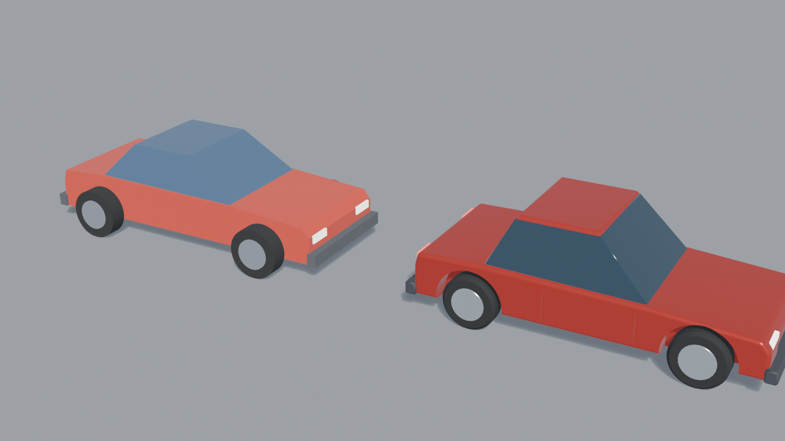

# Scenario 3D OS vs Blender Copilot (2026-11-01)

[Scenario 3D OS](https://github.com/scenario-labs/skills) (MIT, announced 2026-10-30) is a set of agent skills: about 80
playbooks for Blender, Maya, ZBrush and game engines, plus generation skills (image to 3D, textures) that call Scenario's
paid API. Its 15 Blender skills ship pure-bpy helper scripts that run offline: `bx_audit` (an asset gate), `bx_review`
(silhouette / matcap / wire contact sheets) and `bx_hardsurface` (bevel and boolean stacks with shading checks). This page
measures our demo models with them and rebuilds one demo with its method. Nothing here used the paid generation skills.

## 1. Scenario's game gate on the 37 demo models

`bx_audit.deliverable(profile="game")` on every `demos/*/*.glb`: **13 of 37 pass**.

| Finding | Models | Did `check_model` catch it before? |
|---|---|---|
| unapplied scale on a node | 13 (car, castle, robot, windmill, well ...) | yes (`UNAPPLIED_SCALE`, WARN) |
| coplanar overlapping faces between parts (z-fighting) | 14 (castle 8 pairs, windmill 10 ...) | only when two bounding boxes were equal |
| a closed piece inside out | 4 (car cabin, crate-claudesonnet46, house-claudesonnet46, sailboat) | no: the volume test ran on the whole object, which is open |
| a part touching nothing (floating) | 8 (robot 5 parts, castle, watchtower, cannon ...) | no |

The three missing checks are now in `check_model` (`INVERTED_PART` FAIL, `Z_FIGHTING` and `FLOATING_PART` WARN). Run on
the same files, `check_model` now reports them on its own. On the first test run it also found two inside-out headlights
in our own `create_prop car`: `polish_model` used a 4 cm bevel (from the whole car) on a 3 cm part. Fixed with clamped
bevels.

## 2. The car demo rebuilt with the hard-surface method

Same prompt as [demos/car](../../demos/car/): low-poly car, separate hood and trunk line, sloped glass cabin, lights,
bumpers, four wheels with rims, wheels on the ground, no wheels sticking out of the body.
[`build_car.py`](scenario-3d-os/build_car.py) follows the `scenario-blender-hard-surface` workflow: blockout at real
size with no object scale, a 6-segment design bevel on the body silhouette, wheel arches, door seams and a grille pocket
cut with EXACT booleans, an angle-limited micro bevel with Harden Normals and Weighted Normal, then a game copy
(1 micro segment, triangulated, custom normals kept).

| | Old (`demos/car`, Opus 5.5 over MCP, 32 tool calls) | New (hard-surface method) |
|---|---|---|
| Triangles | 1,104 | 4,584 |
| Scenario game gate | fail: 10 unapplied scales, inside-out cabin | **pass** |
| `check_model` (now) | `ok: false` (`INVERTED_PART`) | `ok: true` |
| Wheels | outside the body ("arcade" look, no arches) | in cut arches, on axles |
| Edges | hard, flat shaded | bevelled, catch light |

Four angles, same light: [car_views.png](scenario-3d-os/car_views.png). Contact sheets (silhouette, matcap, wire): [old](scenario-3d-os/car_old_sheet.png), [new](scenario-3d-os/car_new_sheet.png).
The file: [car_hardsurface.glb](scenario-3d-os/car_hardsurface.glb).

The shading audit helped during the build, not only at the end: the first try put the door seams over the curved roof
edge, and `HS.verdict` named both cutters and the bevel they shrank. It still reports one thing on the final body: the
micro bevel clamps where several cuts meet, which keeps that bevel thinner than set.

## 3. What this says

- The gate is the part worth taking: it finds things a picture hides (an inside-out piece, flickering faces) and gives
  the agent numbers. It is now in `check_model`, MIT-ported with credit.
- The hard-surface method makes a cleaner and better-lit model, but about 4x the triangles, and the shape design (the
  profile, the proportions) is still the agent's own. It is a script library for an agent that can run Python; Copilot
  agents use allow-listed tools, so the method would come in as a tool (for example a `hard_surface` mode for
  `polish_model` with design bevel, booleans and weighted normals), not by copying the scripts.
- `DUPLICATE_VERTICES` shows on every imported `.glb`: the glTF importer splits vertices at UV and normal seams. Scenario
  welds before measuring; `check_model` measures the scene as it is, so judge it before export, not on a re-import.
